# Calc Journal: A Front-End and Back-End Separation Calculator

**Author:** Yin Yiping (阴一平) · **FZU Student ID:** 832401228

## Live Public Demo

**🌐 [Open Calc Journal — https://47.117.170.115/](https://47.117.170.115/)**

Open the link in a browser to use the deployed frontend and backend on Alibaba Cloud. No account registration or software installation is required.

| Item | Description |
|---|---|
| Course | 2601_FZU-MU_SE |
| Assignment | [First Assignment — Front-End and Back-End Separation Calculator System](https://bbs.csdn.net/topics/620530837) |
| Objectives | Understand separation of responsibilities, HTTP interfaces, safe expression processing, database persistence, and deployment |
| References | [Vue documentation](https://vuejs.org/guide/), [Express documentation](https://expressjs.com/), [Node.js SQLite documentation](https://nodejs.org/api/sqlite.html), [Google JavaScript Style Guide](https://google.github.io/styleguide/jsguide.html) |
| Deployed application | [https://47.117.170.115/](https://47.117.170.115/) |

## Repository and Code Standard Links

| Submission item | Address / file |
|---|---|
| Front-end GitHub repository | [software-engineering](https://github.com/YinYiping-EE/software-engineering) |
| Back-end GitHub repository | [software-engineering-backend](https://github.com/YinYiping-EE/software-engineering-backend) |
| Front-end code standard | [codestyle.md](https://github.com/YinYiping-EE/software-engineering/blob/main/codestyle.md), based on Google JavaScript Style Guide and Vue documentation |
| Back-end code standard | [codestyle.md](https://github.com/YinYiping-EE/software-engineering-backend/blob/main/codestyle.md), based on Google JavaScript Style Guide |

The two applications have independent local source trees, READMEs, code standards and dependency lockfiles. The frontend handles interaction and presentation; the backend handles validation, calculation and database operations.

## Contents

- [Live Public Demo](#live-public-demo)
- [Repository and Code Standard Links](#repository-and-code-standard-links)
- [PSP Table](#psp-table)
- [Finished Product and Demonstration](#finished-product-and-demonstration)
- [Design and Implementation](#design-and-implementation)
- [Key Code](#key-code)
- [Testing and Deployment](#testing-and-deployment)
- [Personal Learning and Reflection](#personal-learning-and-reflection)
- [References and Assistance](#references-and-assistance)

## PSP Table

The breakdown is a retrospective allocation of the reported total workload of approximately 10 hours. Individual phase values are approximate. The estimated total is 9.5 hours and the actual total is 10 hours.

| Activity | Estimated time (min) | Actual time (min) |
|---|---:|---:|
| Requirement analysis and assignment review | 25 | 30 |
| Architecture, API and database design | 35 | 40 |
| Code standard preparation | 10 | 10 |
| Front-end implementation and interaction | 150 | 155 |
| Back-end HTTP interfaces | 85 | 90 |
| Expression parser and error handling | 45 | 50 |
| Database and history module | 30 | 30 |
| Integration and testing | 70 | 75 |
| Deployment and demonstration | 45 | 45 |
| Code review and improvements | 25 | 25 |
| Blog writing and submission preparation | 50 | 50 |
| **Total** | **570 (9.5 h)** | **600 (10 h)** |

Most time was allocated to frontend interaction, backend interfaces and integration checks. Verification focused on correct calculation, database writes, retained history and deletion state.

## Finished Product and Demonstration

The application accepts arithmetic expressions and saves successful calculations. It supports addition, subtraction, multiplication, division, precedence, parentheses, decimals and unary signs. Invalid expressions and division by zero produce understandable errors without creating history records. The front end sends only an expression; the back end returns the calculated result.

Open the deployed URL, enter `1+2*3`, and press Enter or **Calculate & save**. The result should be `7`, and the new record should appear in history. Refresh the page to query it again. Use the trash button on a record you created to delete that specific record. There is no account registration: a signed anonymous browser identity scopes the history.

Screenshots 1–11 were captured from actual local browser interactions on October 5. Screenshots 12–15 preserve the earlier October 4 persistence demonstration; the visual styling is older. Its behavior was rechecked on October 5 using real isolated HTTP requests and backend process restarts. Screenshots 16–17 demonstrate the later music and bilingual cloud features. Local screenshots show local request addresses, not a visitor's public IP.

### 1. Main interface

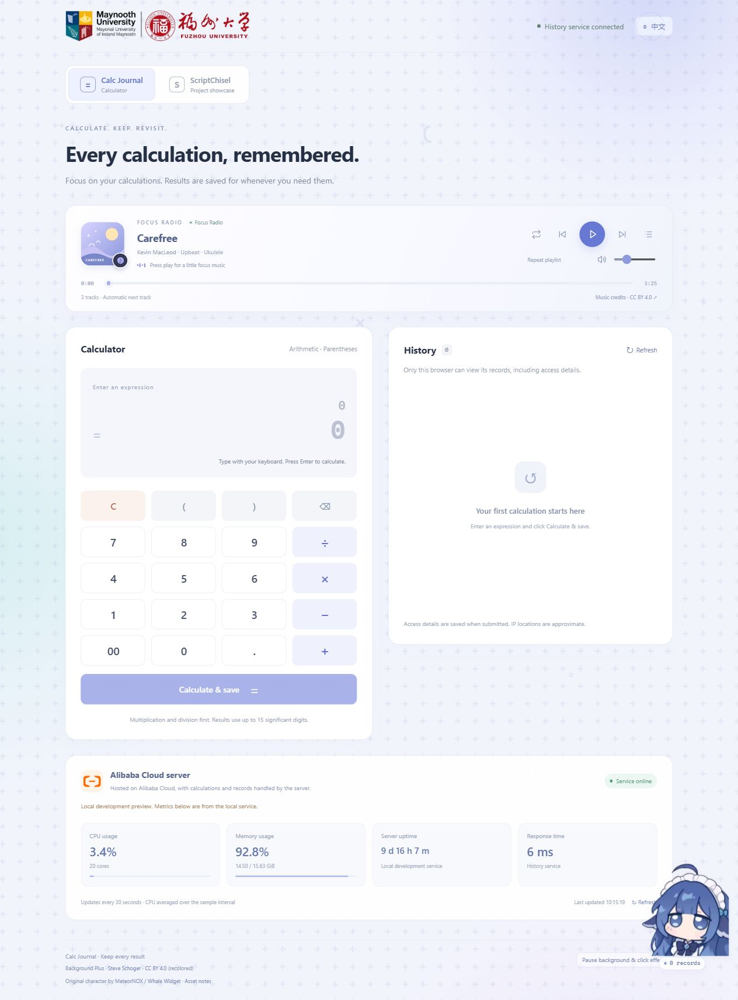

*Figure 1. Main interface*

The input area, keypad and history panel form the main workflow. History is returned by the API rather than reconstructed from browser storage.

### 2. Addition

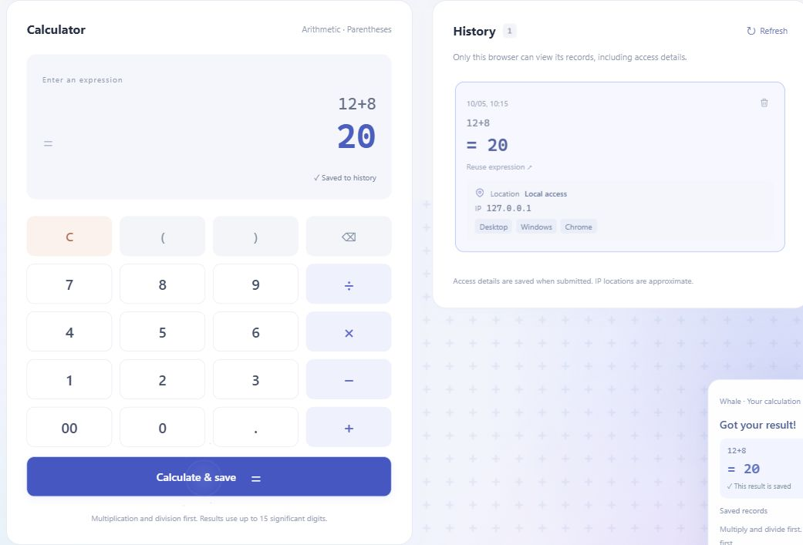

*Figure 2. Addition*

`12+8` returns `20`; successful submission creates a history entry with its submission time and source details.

### 3. Subtraction


*Figure 3. Subtraction*

`12-8` returns `4`, confirming the basic subtraction path.

### 4. Multiplication

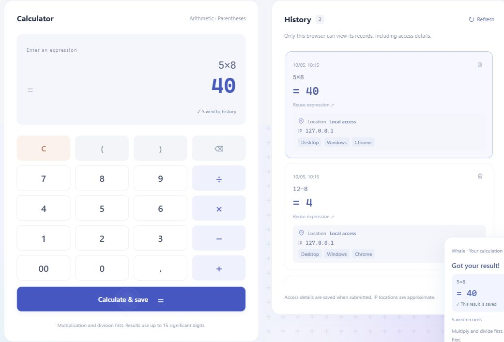

*Figure 4. Multiplication*

`5×8` returns `40`. The backend normalizes the display symbol to `*` before parsing.

### 5. Division

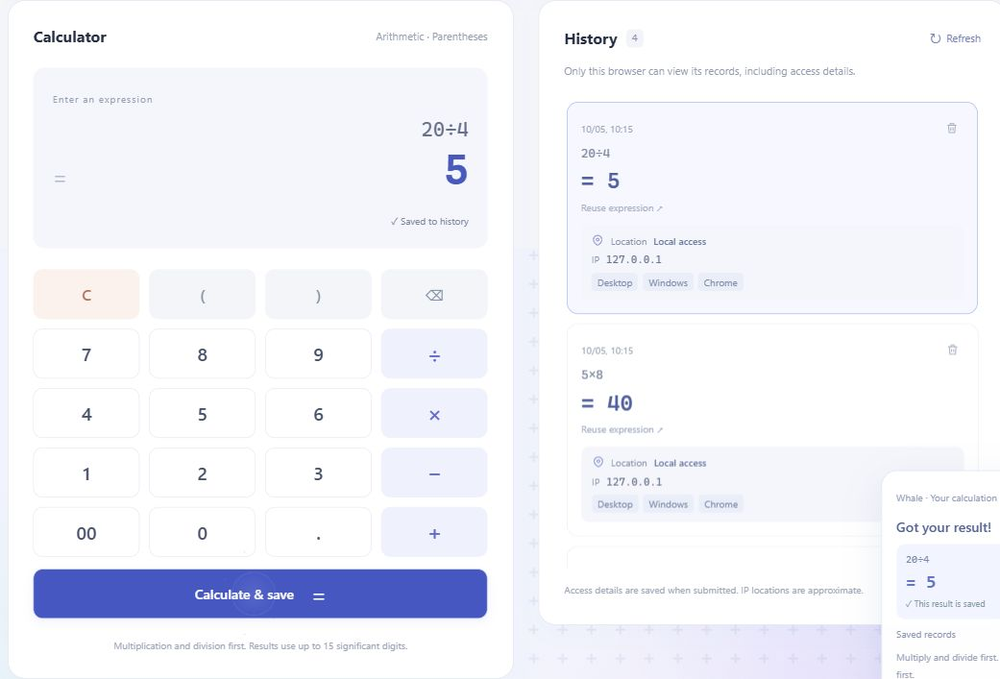

*Figure 5. Division*

`20÷4` returns `5`. Normal division and division-by-zero errors are handled separately.

### 6. Decimal calculation

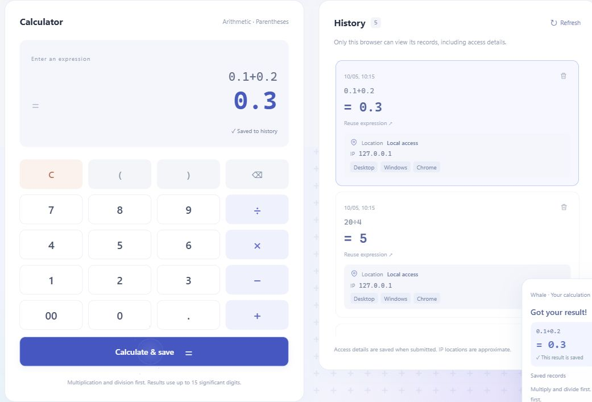

*Figure 6. Decimals*

`0.1+0.2` is displayed as `0.3`. Arithmetic uses JavaScript Number with up to 15 significant digits for non-safe-integer output; this is not an arbitrary-precision engine.

### 7. Operator precedence

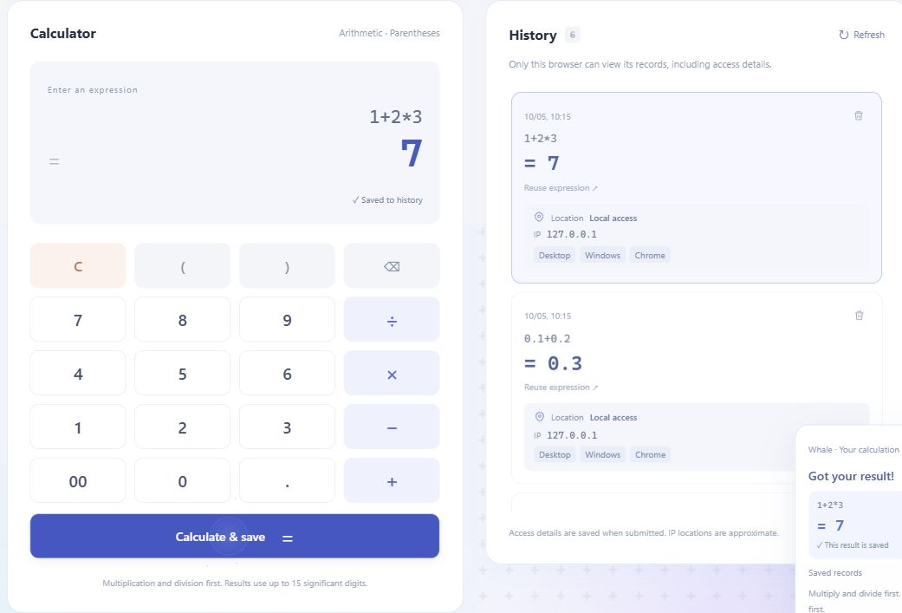

*Figure 7. Precedence*

`1+2*3` returns `7`, because multiplication is evaluated before addition.

### 8. Parentheses


*Figure 8. Parentheses*

`(1+2)*3` returns `9`, showing that parentheses override the default order.

### 9. Unary minus


*Figure 9. Unary minus*

`3*-2` returns `-6`; the unary parser treats the minus sign as part of the following operand. Automated tests also cover `+2+3`, `-5+8` and `-(2+3)*4`.

### 10. Invalid expression

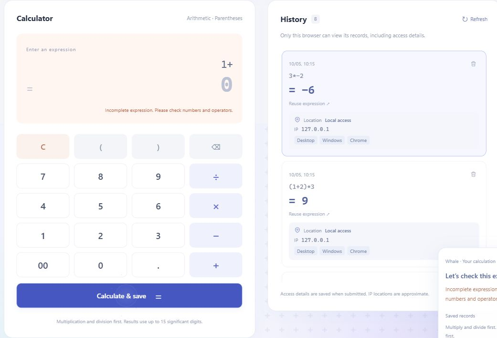

*Figure 10. Invalid expression*

`1+` produces an incomplete-expression error. The history count remains eight.

### 11. Division by zero

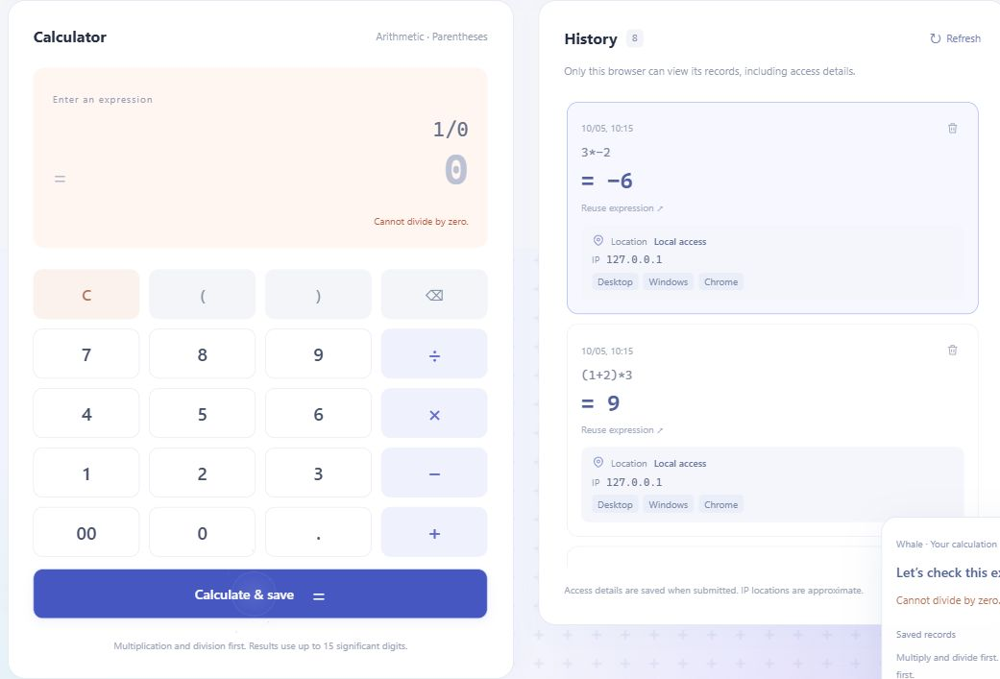

*Figure 11. Division by zero*

`1/0` displays a division-by-zero error and adds no record.

### 12. History after refresh

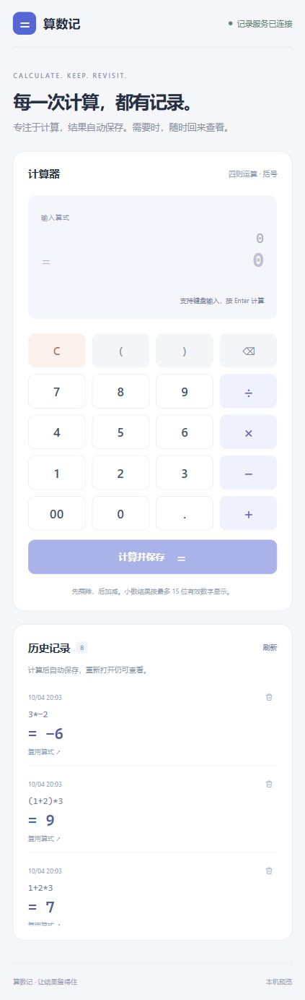

*Figure 12. Refresh persistence, earlier interface*

The October 4 demonstration shows all eight records after a reload. A fresh database query on October 5 also returned the eight independently created test records.

### 13. Backend stopped

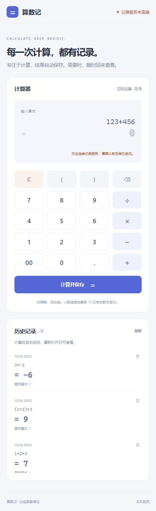

*Figure 13. Backend offline, earlier interface*

The earlier browser demonstration accepts input while the stopped backend cannot return a new result. The October 5 isolated process test again confirmed request failure after backend shutdown.

### 14. Backend restarted


*Figure 14. Restart persistence, earlier interface*

Records survive the backend restart because they are stored in SQLite. The October 5 test terminated and relaunched the actual backend process using the same database and signing key; eight records were returned.

### 15. Delete one record


*Figure 15. Specified record deletion, earlier interface*

Deleting the subtraction record leaves seven other records. The latest API audit repeated this operation by ID and restarted the backend again; the deleted ID stayed absent and the other seven remained.

### 16. Music player and album thumbnails


*Figure 16. Music player*

The player contains three credited tracks and independent cover thumbnails. After an initial user playback action, the default playlist continues automatically. Repeat-one, shuffle and sequential modes are also implemented; a page reload does not force playback.

### 17. English interface and cloud status


*Figure 17. English interface and cloud metrics*

The language switch changes calculator labels, history details, errors, the player, the whale assistant and the server card. The deployed status card shows actual server measurements. The college logo opens the specified college website.

## Design and Implementation

### Requirement analysis and functional structure

The four core responsibilities are calculation, compound expression processing, persistent history and deleting a specified record. A visible interface alone cannot prove separation or persistence, so the design also includes offline-backend and restart checks.

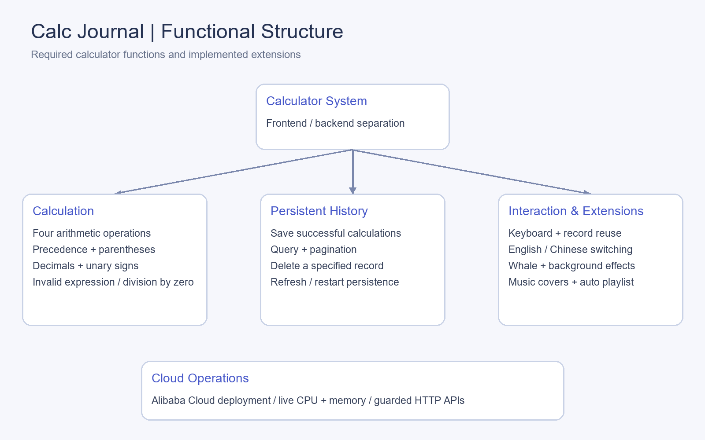

*Figure 18. Functional structure*

Optional extensions include history pagination, keyboard input, record reuse, browser-scoped history, source metadata, bilingual labels, a draggable responsive whale, animation controls, music and live server metrics. Anonymous browser identity is not an account login feature. Scientific functions and clear-all history are not claimed.

### Overall architecture

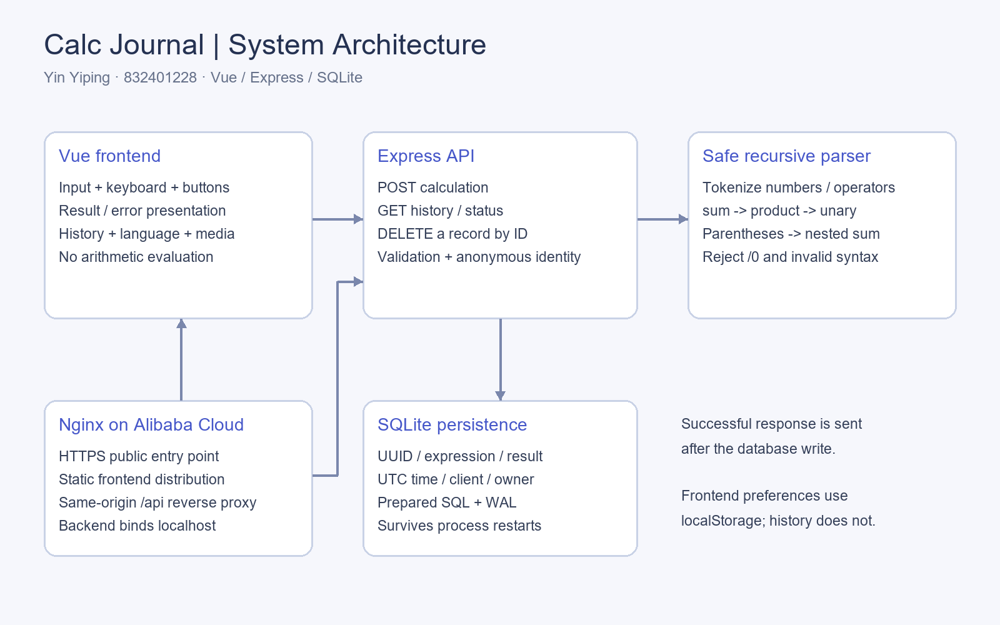

*Figure 19. System architecture*

Vue owns interaction and presentation. Express owns validation, expression processing and database access. They communicate using HTTP/JSON. During development, Vite proxies `/api` to the backend. In production, Nginx serves the built frontend and proxies the same relative `/api` paths to a backend bound to localhost. This keeps the frontend independent of a hard-coded backend address while retaining separate application responsibilities.

### Technology choices and reasons

| Technology | Responsibility | Reason for choosing it |
|---|---|---|
| Vue + Vite | Frontend components and build | Reactive state displays responses and history; media, the whale and status remain separate components; the build produces independent static files |
| Node.js + Express | Backend HTTP service | Routes, calculation and storage can be tested separately and connected through explicit JSON contracts |
| SQLite | Persistent history | A single-file database suits this small project without another database service; first startup initializes it |
| Custom recursive descent parser | Expression processing | A limited arithmetic grammar provides control over precedence, errors and bounds without executing user code |
| Nginx + systemd | Cloud operations | HTTPS, static hosting, reverse proxying and backend service management have distinct responsibilities |

### Front-end design

`App.vue` maintains the expression, loading state, returned calculation and history list. It submits an expression, checks the response and displays the backend result. It contains no arithmetic evaluator. History is refreshed after successful insertion or deletion; request sequence numbers prevent an older response from overwriting a newer list.

The layout adapts to narrower screens. Buttons and controls have accessible names and keyboard support. Result and history transitions provide feedback; background and click effects can be paused and respect reduced-motion preferences. Separate components manage music, whale behavior and server status, keeping them outside the calculation flow. localStorage holds preferences such as language and widget position, never the authoritative history.

### Back-end design and API contract

| Method and path | Responsibility | Normal response |
|---|---|---|
| `POST /api/calculations` | Validate, calculate and save `{expression}` | 201; persisted record |
| `GET /api/calculations?limit=20&offset=0` | Query the current browser's records | 200; `items` and `total` |
| `DELETE /api/calculations/{id}` | Delete the owned database record | 204; no body |
| `GET /api/health` | Basic service check | 200 |
| `GET /api/status` | Database check and aggregate host metrics | 200 |

For example, `{"expression":"(1+2)*3"}` produces a record containing `success`, UUID `id`, `expression`, string `result: "9"`, ISO `createdAt`, and client metadata. Errors return `success: false` and a safe message. Invalid expressions use 400; an absent or unowned deletion uses 404; bad content type uses 415; oversized JSON uses 413; throttling uses 429. Internal failures use a generic 500 response.

`calculator.js` handles arithmetic; `history-store.js` handles storage; `client-info.js` reads request metadata; `protection.js` guards HTTP access; `system-status.js` samples metrics; `app.js` connects these modules to routes; `server.js` loads configuration and starts the service.

### Database design

| Field | SQLite type | Purpose |
|---|---|---|
| `id` | TEXT primary key | Server-generated UUID |
| `expression` | TEXT, non-null | Original successful expression |
| `result` | TEXT, non-null | Formatted result |
| `created_at` | TEXT, non-null | UTC ISO timestamp |
| `client_info` | Nullable TEXT | JSON containing IP, approximate location and device labels |
| `owner_id` | Nullable TEXT | Server-issued anonymous browser identity |

SQLite uses WAL and parameterized prepared statements. An owner/date index supports scoped chronological queries. Schema migration adds new columns without removing earlier rows. Successful calculations are saved before the API sends success; unsuccessful expressions are not inserted. Deletion uses both record ID and owner ID, then the frontend re-queries the list.

In production, the database is outside the release directory. Code updates and process restarts therefore preserve data. Clearing the browser cookie does not erase the database, but the new anonymous identity cannot access records belonging to the previous identity.

### Expression parser

The tokenizer accepts numbers, arithmetic operators and parentheses. Unicode multiplication, division and minus symbols are normalized. Numbers support decimals and scientific notation. The grammar is:

```text
sum     := product (("+" | "-") product)*
product := unary (("*" | "/") unary)*
unary   := ("+" | "-") unary | primary
primary := number | "(" sum ")"
```

Each level calls the higher-precedence level. Parsing a parenthesis recursively calls `sum`. The final token position must equal the token count. This rejects extra operands or unmatched syntax. Expression length is limited to 200 characters, and every intermediate multiplication, division, addition or subtraction checks for a finite result. No user expression is executed as general-purpose code.

### History flow and exceptions

The normal sequence is: enter expression → POST expression → validate and parse → save to SQLite → return stored record → display result → GET updated history. For deletion: click a record's trash button → DELETE its ID → backend deletes owned row → 204 → GET updated history.

On a parse error, the backend returns 400 and skips storage. On network failure, the frontend shows a connection message rather than calculating an answer locally. On a database failure, the API does not report successful saving. Existing displayed results are historical values, not evidence that a new expression can be computed offline.

### Source details and protection

Each new record stores request IP, approximate offline IP location, operating-system, browser and device labels. Local and private addresses are identified explicitly. IP location is an estimate rather than a physical login location, and User-Agent labels can be spoofed. The application has no account login system.

Browser identity is signed and stored in an HttpOnly, SameSite=Strict cookie; production adds Secure. The backend rejects cross-site requests, requires a custom header for writes, limits JSON to 2 KB and throttles per-IP requests. SQLite parameters prevent input from becoming SQL. The public status API exposes aggregate measurements rather than environment variables or process details. These checks reduce common misuse but are not a claim of exhaustive penetration testing.

## Key Code

The excerpts below are taken from the actual project. They show responsibility boundaries rather than an entire generated listing.

### Frontend sends the expression

From `frontend/src/App.vue`:

```js
const response = await fetch('/api/calculations', {
  method: 'POST',
  headers: {'Content-Type': 'application/json', 'X-Calculator-Request': '1'},
  body: JSON.stringify({expression: expression.value}),
  signal: AbortSignal.timeout(5000),
});
```

Only the expression is sent. A timeout bounds waiting, and the backend remains the source of the new result.

### Backend calculates before saving

From `backend/src/app.js`:

```js
const calculation = calculate(request.body?.expression);
response.status(201).json({success: true,
  ...store.save(calculation, readClientInfo(request), request.ownerId)});
```

The call order makes successful parsing and storage prerequisites for a successful response. Parser exceptions are caught and returned as 400 errors.

### Multiplication, division and unary operands

From `backend/src/calculator.js`:

```js
function product() {
  let value = unary();
  while (peek() === '*' || peek() === '/') {
    const operator = tokens[index++].type;
    const right = unary();
    if (operator === '/' && right === 0) throw new CalculationError('不能除以零');
    value = finite(operator === '*' ? value * right : value / right);
  }
  return value;
}
```

Reading operands through `unary()` permits expressions such as `3*-2`. This function is called from `sum()`, which gives multiplication and division their higher precedence.

### Delete in the database, scoped by owner

From `backend/src/history-store.js`:

```js
const ownedRemove = database.prepare(
  'DELETE FROM calculations WHERE id = ? AND owner_id = ?');
```

Bound parameters protect the query structure and require both identifiers to match. After the HTTP response, the frontend calls `loadHistory()`; it does not merely hide an element and pretend deletion succeeded.

## Testing and Deployment

The source publication review found zero known dependency vulnerabilities at the time of the audit. It checked restricted parsing, parameterized SQL, anonymous identity isolation, cross-site protections and credential exposure in publication files. Public injection and unauthorized deletion checks were rejected; only the exact generated test record was removed. Existing visitor records were preserved. Databases, runtime environment files and private keys are excluded from public repositories. These checks are not an exhaustive penetration test.

The latest local verification on October 5, 2026 passed **47 automated tests**, the backend syntax checks and the frontend production build. Tests cover arithmetic, parsing boundaries, invalid expressions, real HTTP endpoints, persistence, deletion, pagination, source metadata, migrations, identity isolation, cross-site checks, rate limits and metrics. Tests use isolated databases.

An additional live-process audit created eight records, rejected `1+`, `1/0` and `process.exit()`, stopped the backend, checked connection failure, restarted it and queried all eight records. It then deleted one specific ID and restarted again, confirming exactly seven retained records. The report is saved with the assignment materials in `api-audit.json`.

The production application is hosted on an Alibaba Cloud Ubuntu 24.04 server with two CPU cores. Nginx handles HTTPS and static files; systemd runs the backend as a dedicated service with a memory limit. Runtime secrets and persistent SQLite data are stored separately from code releases. The server profile was sold as 2 GB, while the operating system reports approximately 1.58 GiB total usable memory; the status card reports measured values. The October 5 check found both Nginx and the calculator service active and the health/status endpoints responding.

The deployment sequence is:

1. Pass the local tests, build the frontend and place `dist` in a server release directory for Nginx to serve.
2. Install production backend dependencies and configure a separate persistent database and session key; keep runtime configuration outside the source directory.
3. Bind the API to `127.0.0.1:3001`; proxy same-origin `/api` traffic through Nginx and overwrite visitor forwarding headers.
4. Use systemd for startup, restart and memory limits, with HTTPS renewal and SQLite backups.
5. Check HTTP-to-HTTPS redirection, health, metrics and actual calculation/history/deletion. Keep the public service online during evaluation.

For local reproduction, use Node.js 24.12 or later. In the backend repository run `npm ci`, copy `.env.example` to `.env` if configuration is needed, and run `npm run dev`. First startup initializes SQLite. In the frontend repository run `npm ci` and `npm run dev`; visit `http://127.0.0.1:5173/`. Both repositories have standalone lockfiles and instructions. Keep the backend database and session key when testing restart persistence.

For a short demonstration, show `12+8`, `1+2*3`, `(1+2)*3`, `3*-2`, `0.1+0.2`, the two error cases, refresh persistence and deletion of your own test record. Then demonstrate the language switch and live cloud status. Backend shutdown/restart tests should be done in the isolated local environment to avoid interrupting the grading site.

## Personal Learning and Reflection

### Actual problems and their solutions

| Problem | Diagnostic evidence | Solution and verification |
|---|---|---|
| Earlier history endpoints did not isolate visitors | Public list and delete operations lacked owner filtering, potentially exposing record metadata to other visitors | Add a signed anonymous identity and scope queries/deletes by `owner_id`; two identities cannot see each other's records and a foreign deletion returns 404 |
| Concurrent first-load requests could compete to establish browser identity | History and status load together; if both issued a new identity cookie, response order could affect later ownership | Make `/api/status` a public aggregate endpoint without history cookie issuance; regression tests confirm no Set-Cookie while history retains identity handling |
| Local isolated-test history disappeared from the display after a reload | Rows remained in SQLite, but different development services on the same hostname share cookies across ports | Preserve an independent HTTP client's test cookie and signing key across actual backend process restarts; verify eight retained records, then seven after deleting one ID and restarting again |

These checks distinguish presentation state, browser identity and persistent database state. Diagnosing missing history requires checking the response, identity changes and stored rows rather than assuming that an empty list proves data loss.

### Understanding the separation boundary

The main lesson I take from this project is that front-end/back-end separation is a division of responsibility enforced through an interface. Separating folders is useful, but the essential question is which side owns each operation. In this calculator, the frontend describes a calculation request and presents the response; the backend decides whether the expression is valid, computes its result and persists it. This boundary makes it possible to change the interface without changing the calculation rules.

The API contract connects the two applications. A request such as `{"expression":"(1+2)*3"}` has a clear meaning, and its success or failure must be reflected consistently in status codes and response fields. This also helps locate problems: an incorrect expression result points toward the parser, an incorrect saved list toward storage or querying, and an inaccessible service toward the network or deployment configuration. I would preserve that separation when adding another client.

Persistence also clarifies ownership. A list displayed in a component is temporary presentation state. SQLite records remain after a page reload or backend restart, and deleting a record is complete only when the database no longer contains it. Re-querying history after a write gives the interface a reliable view of the backend state. Browser storage is useful for preferences, but using it as the history database would fail the architectural goal.

Safe expression processing shows why backend validation matters. The backend cannot assume that all requests were produced by its own keypad. Tokenization and a small grammar give it explicit control over valid numbers, operators and precedence without executing user code. Handling unary signs and parentheses in separate parser levels makes the rules easier to explain and test.

The project also illustrates the difference between development and deployment. A relative `/api` address works locally through Vite and in production through Nginx, while the two applications keep their own code, dependencies and startup procedures. Configuration, persistent files and secrets need lifetimes independent of a code release. This makes an update less likely to erase history or change browser identity unexpectedly.

If extending the project, I would prioritize exact-decimal arithmetic, searchable history, clearer API documentation and more systematic accessibility checks. If account-based synchronization were added, it would need a real authentication design rather than treating an IP address or User-Agent as identity. I would also keep the core calculator usable when decorative media is disabled.

## References and Assistance

- Assignment specification: [CSDN course assignment](https://bbs.csdn.net/topics/620530837).
- Framework and runtime: [Vue](https://vuejs.org/guide/), [Express](https://expressjs.com/), [Node.js SQLite](https://nodejs.org/api/sqlite.html).
- Code standard: [Google JavaScript Style Guide](https://google.github.io/styleguide/jsguide.html), with documented project adaptations.
- Background: Steve Schoger's Plus pattern from [Hero Patterns](https://heropatterns.com/), recolored, credited under CC BY 4.0.
- Whale character: [MeteorNOX / DeepSeek-Balance-Whale-Widget](https://github.com/MeteorNOX/DeepSeek-Balance-Whale-Widget). The original image is retained; the upstream asset notice is included. This attribution does not imply an unrestricted license for all uses.
- Music: Kevin MacLeod, three credited tracks; individual source and CC BY 4.0 details are retained in the application's music credits.
- The MU/FZU and Alibaba Cloud marks were supplied by the user for this course demonstration; they do not imply institutional endorsement.

AI assistance was used in implementation, debugging, verification and writing. The explanations above describe the actual source code, API boundary, parser and persistence evidence.
