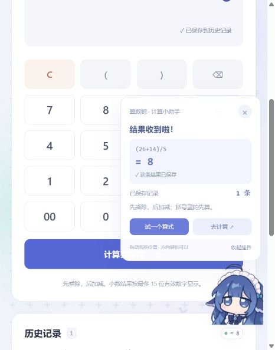
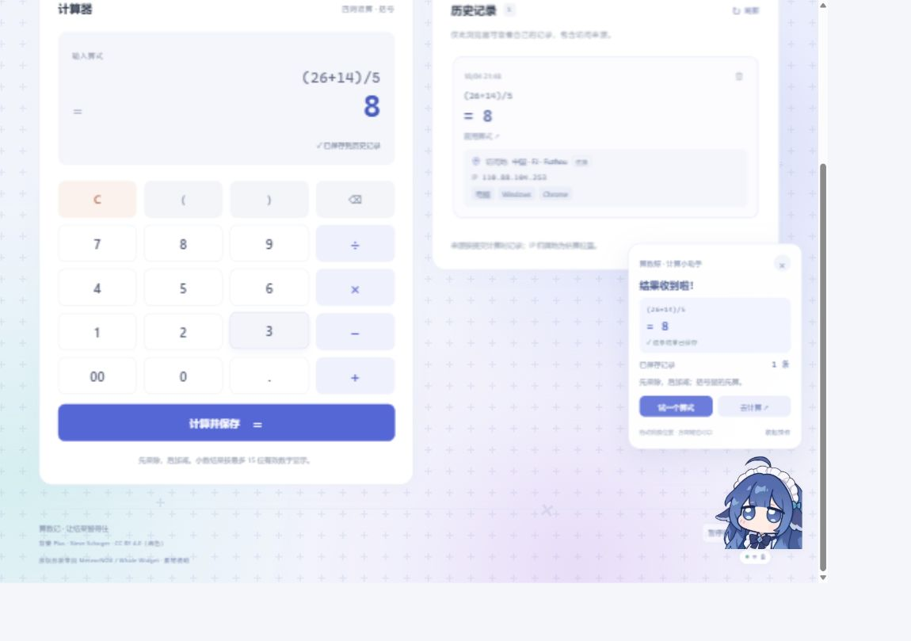
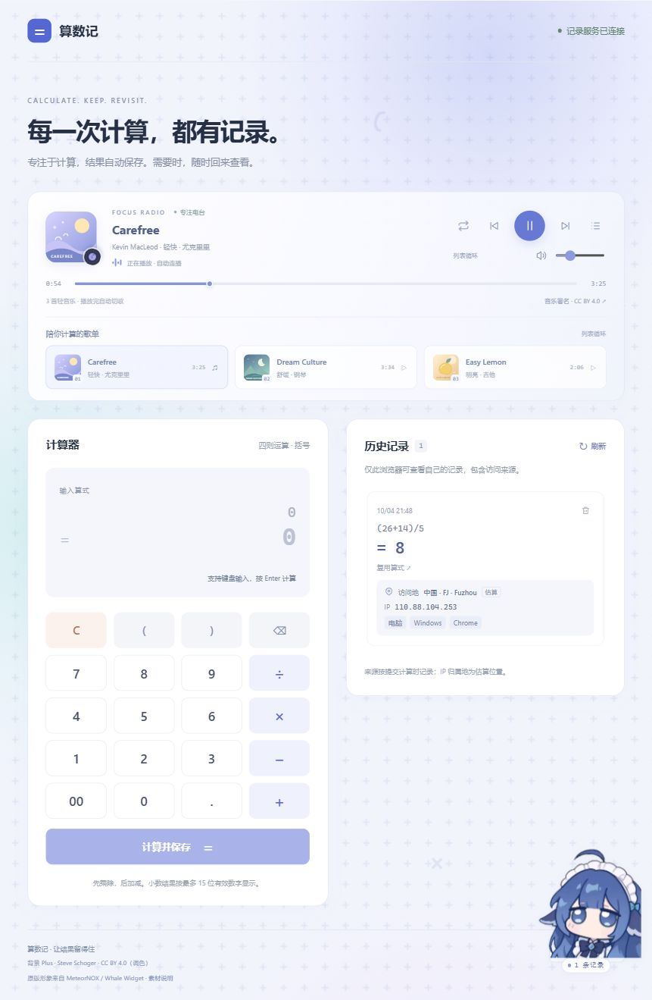
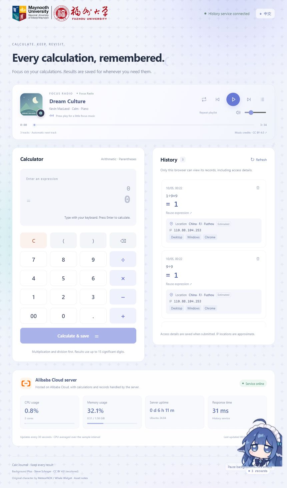

# 实际运行截图

这些截图来自 2026-10-04 本机实际运行的 Vue 网页和 Express + SQLite 后端。演示数据均由测试过程生成，测试结束后只删除了对应测试记录。用户后续新增的记录不应被清理。

| 图片 | 演示内容 |
|---|---|
| [01-home.png](screenshots/01-home.png) | 首页、输入按钮和初始历史状态 |
| [02-addition.png](screenshots/02-addition.png) | 12+8=20，成功后保存记录 |
| [03-subtraction.png](screenshots/03-subtraction.png) | 12−8=4 |
| [04-multiplication.png](screenshots/04-multiplication.png) | 5×8=40 |
| [05-division.png](screenshots/05-division.png) | 20÷4=5 |
| [06-decimal.png](screenshots/06-decimal.png) | 0.1+0.2=0.3 |
| [07-precedence.png](screenshots/07-precedence.png) | 1+2×3=7，体现优先级 |
| [08-parentheses.png](screenshots/08-parentheses.png) | (1+2)×3=9 |
| [09-unary-minus.png](screenshots/09-unary-minus.png) | 3×−2=−6 |
| [10-invalid-expression.png](screenshots/10-invalid-expression.png) | 不完整算式返回错误，不新增记录 |
| [11-division-by-zero.png](screenshots/11-division-by-zero.png) | 除零提示，不新增记录 |
| [12-history-after-refresh.png](screenshots/12-history-after-refresh.png) | 刷新网页后 8 条记录仍可读取 |
| [13-backend-offline.png](screenshots/13-backend-offline.png) | 停止后端，前端仍可输入但无法算出新结果 |
| [14-history-after-backend-restart.png](screenshots/14-history-after-backend-restart.png) | 重启后端后 8 条记录仍保留 |
| [15-reuse-history.png](screenshots/15-reuse-history.png) | 点击历史记录复用算式和已有结果 |
| [16-after-record-deletion.png](screenshots/16-after-record-deletion.png) | 经 DELETE API 删除减法记录后，页面显示剩余 7 条 |
| [17-record-source-mobile.png](screenshots/17-record-source-mobile.png) | 新版卡片显示本机访问、127.0.0.1、电脑 / Windows / Chrome，旧记录注明来源未记录；窄屏布局及复用提示 |
| [18-animated-background-mobile.png](screenshots/18-animated-background-mobile.png) | 网页加入 Plus 素材背景、光晕和漂浮运算符，页脚提供背景及点击动效开关与素材署名 |
| [20-calculator-whale.png](screenshots/20-calculator-whale.png) | 历史版本：重绘形象，气泡联动 0.1+0.2=0.3；当前已按用户要求改为原版鲸鱼娘 |
| [22-original-whale.png](screenshots/22-original-whale.png) | 当前版本：原版鲸鱼娘形象与计算器提示气泡，PNG 文件与上游完全一致 |

删除验证采用真实后端 API，随后重新加载网页核对数据库最新状态。自动测试还验证了删除状态在数据库重新打开后保持。

博客中可按这些实际功能编排说明。公开访问地址、GitHub 地址和个人开发体会仍需在完成相应工作后填入。

来源信息验证：计算 `(18+24)×2` 得到 84，刷新后来源字段仍保留，点击卡片可复用。该演示新建的记录在验证后通过指定 ID 清理，原有三条用户记录保留。浏览器中检查了按键波纹动画（0.5 秒）且未发现运行错误。静态截图仅展示界面状态，不能替代动效演示。

背景与点击效果验证：浏览器确认三个光晕层、运行中的背景动画，以及点击后的一组光圈和七个粒子；暂停按钮将动画状态切为 paused 并清除粒子，重新开启后恢复。窄屏（466 CSS 像素）和桌面（1150 CSS 像素）布局均无横向溢出，桌面呈现双列。未执行计算或改动历史记录，未发现浏览器运行错误。素材授权见 `asset-sources.md`。

算数鲸验证：点击气泡填入示例 `0.1+0.2`，用户操作 Enter 后得到后端结果 0.3，气泡及记录数量同步更新；`1/0` 联动除零提示且没有新增记录。拖动到左侧完成贴边、镜像及气泡收起；方向键移动后刷新位置保留，收起状态刷新后保留且能唤醒。桌面与窄屏检查了挂件和气泡边界，Escape 可关闭提示而保留当前算式，浏览器没有运行错误。测试新建的记录只按该记录 ID 清理。原项目参考与形象说明见 `whale-widget.md`。

原版形象验证：图片按原文件接入（610 × 610，Git blob 校验一致），浏览器确认图片加载、点击气泡、鼠标拖动、方向键恢复位置以及挂件 / 气泡处于屏幕内；图片不会触发浏览器默认图片拖拽。39 项接口回归测试及前端构建通过，未新增或删除用户历史。

## 公网上线验证（2026-10-04）

公开地址：<https://47.117.170.115/>。43 项自动测试和公网接口防护检查通过，详情见 ../../docs/security-check.md。

## 专注电台与封面验证（2026-10-05）

三首轻音乐可实际播放，当前歌曲封面与歌单缩略图全部加载。通过真实进度滑块到曲末验证单曲重播、默认列表自动切歌及末曲回到首曲；顺序播放末曲结束停止。检查了手动切歌、暂停切歌、随机模式、静音、零音量恢复，以及音乐控件键盘不干扰算式输入。手机 375 × 844 与桌面均无横向溢出，四张可见封面全部正常加载。

发布前和服务器各 43 项自动测试通过。公网音乐 Content-Type 为 audio/mpeg，Range 返回 206 和正确的 Content-Range；服务器音频 SHA-256 与本地清单一致。公网播放器读取到实际播放进度、完整音频时长及 readyState 4，主封面和三张缩略图正常加载。未新增或删除计算记录。

## 中英文、标识与服务器状态（2026-10-05）

已验证中英文整页切换，包括计算器、记录来源、音乐播放器和算数鲸提示；只有语言返回按钮保留“中文”。切换保持输入不变，播放不中断，除零错误随语言重新翻译；刷新记住语言且不自动开始音乐。手机 375 × 844 和桌面检查无横向溢出；公网 961 CSS 像素宽度下顶部连接提示和语言按钮保持完整单行。用户提供的两张标识文件 SHA-256 与项目副本一致，学院 Logo 加载完整且链接指向指定官网。

背景速度提升 30%：浏览器实际读到光晕周期 16.9231 秒（原 22 秒），纹理周期 27.6923 秒（原 36 秒）。暂停规则保留。阿里云卡片通过真实 API 显示服务器 2 核 CPU、内存、系统运行时间和响应耗时；生产 provider 为 aliyun，本机为 local 并明确提示。公网每 30 秒采样更新，Cache-Control 为 no-store，不创建历史 Cookie。原有三条公网记录正常显示，未新增或删除记录。

本地与服务器各 47 项测试通过，新增测试覆盖指标采样、5 秒缓存、空值、内存边界、数据库检查失败、来源校验、无 Cookie 和 IP 限流。

